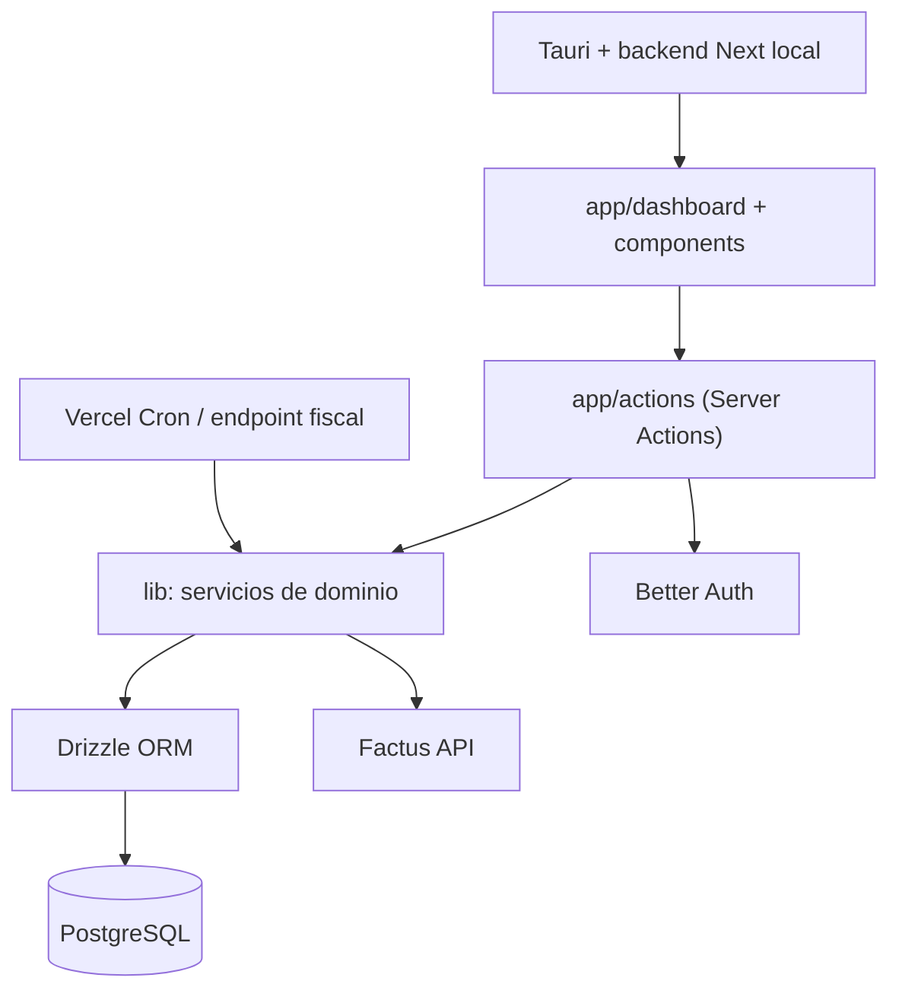

---
tags:
  - arquitectura
  - stack
estado: documentada
ruta-codigo:
  - app/
  - components/
  - app/actions/
  - lib/
  - lib/db/
  - proxy.ts
  - next.config.mjs
---

# Arquitectura general

## Resumen

Aplicación web de punto de venta para comercio colombiano. El UI está en Next.js App Router; operaciones internas usan Server Actions; la lógica se reparte entre esas acciones y servicios de dominio en `lib/`. Drizzle conecta a PostgreSQL. Factus es una integración externa para emisión electrónica.

La interfaz web no consume una API REST interna para cada pantalla: usa Server Actions. Hay rutas API para autenticación, cron, webhooks, salud, setup, backup, PDF de inventario y una API pública de facturas.

## Persistencia y tenancy observados

`lib/db/index.ts` crea un solo `pg.Pool` con `DATABASE_URL` y exporta `db`. Las acciones de dominio consultadas importan ese `db`; usan `tenantId` en consultas para delimitar los registros. No se encontró uso de `getTenantDb()` fuera de su módulo: aunque `tenant-connection.ts` y `tenant-provisioner.ts` implementan/contemplan bases `pos_tenant_<slug>`, no se debe describir esa estrategia como activa en el flujo web sin confirmar su integración.

> [!question] Por verificar
> Confirmar el diseño de aislamiento multiempresa deseado y si se pretende base única con filtros por `tenantId` o una base física por empresa. Ver [[06-Decisiones-y-pendientes/Deuda-tecnica-y-por-verificar]].

## Seguridad de rutas

`proxy.ts` protege prefijos de dashboard/POS, API v1 y reportes mediante cookie de sesión; el manejador API v1 valida además API key y alcance. Server Actions resuelven sesión, membresía, empresa y rol. `next.config.mjs` añade CSP y `Permissions-Policy`; el proxy añade otras cabeceras.

## Límites

- No se encontró NestJS, Prisma, Redis ni BullMQ en el flujo principal.
- Existe una cola fiscal durable propia en PostgreSQL; no es una cola externa.
- El código usa PostgreSQL. Comentarios de SQLite/Tauri en algunos módulos no describen por sí solos el runtime de escritorio actual.
- Ver [[01-Arquitectura/Stack-y-dependencias]], [[03-Datos/Modelo-de-datos]] y [[04-Interfaces/API-y-rutas]].
