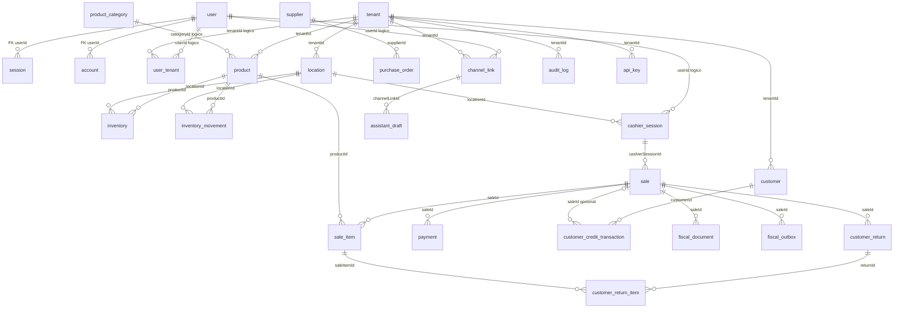

---
tags:
  - datos
  - base-de-datos
  - modelo
estado: documentada
ruta-codigo:
  - lib/db/schema/index.ts
  - lib/db/schema/auth.ts
  - lib/db/schema/tenancy.ts
  - lib/db/schema/catalog.ts
  - lib/db/schema/customers.ts
  - lib/db/schema/sales.ts
  - lib/db/schema/fiscal.ts
  - lib/db/schema/outbox.ts
  - lib/db/schema/purchasing.ts
  - lib/db/schema/returns.ts
  - lib/db/schema/assistant.ts
  - lib/db/schema/audit.ts
  - lib/db/schema/platform.ts
---

# Modelo de datos

Fuente Drizzle: `lib/db/schema/index.ts`, que exporta los 12 módulos que siguen. La exploración contó 33 llamadas `pgTable()` en ellos. Las tablas guardan identificadores `text`; los importes y cantidades usan principalmente `numeric/decimal`; estados de dominio se representan como texto.

> [!warning] Relaciones y restricciones
> Solo se encontraron `.references()` explícitos en `session.userId → user.id` y `account.userId → user.id`. Muchas otras asociaciones se realizan por columnas `...Id` y joins en servicios, sin FK declarada en los esquemas Drizzle consultados. Las líneas del diagrama son relaciones lógicas de aplicación; no implican integridad referencial en PostgreSQL.

## Tablas y campos representativos

| Grupo | Tabla | Campos/propósito principales |
|---|---|---|
| Auth | `user` | `id`, nombre, email único, verificación, timestamps |
| Auth | `session` | token único, expiración, `userId` (FK a user) |
| Auth | `account` | proveedor, accountId, credenciales/tokens, `userId` (FK) |
| Auth | `verification` | identificador, valor y expiración |
| Empresa | `tenant` | identidad legal, NIT, configuración DIAN/Factus, assistant, crédito, estado |
| Empresa | `user_tenant` | empresa, usuario, rol y estado; pareja user/tenant única |
| Empresa | `location` | sede, código, dirección y estado |
| Catálogo | `product` | SKU, barcode, categoría, precio/costo, IVA, tratamiento |
| Catálogo | `inventory` | producto/sede, cantidad, reservado, disponible, punto de reposición |
| Catálogo | `product_category` | nombre/slug, descripción, color y estado |
| Catálogo | `inventory_movement` | producto/sede, tipo, cantidad, referencia e idempotencia |
| Clientes | `customer` | identificación/contacto, datos tributarios, cupo y saldo |
| Clientes | `customer_credit_transaction` | cargo/abono, importe, saldo, venta, vencimiento/estado |
| Caja/ventas | `cashier_session` | usuario/sede, fecha negocio, apertura/cierre, saldos y totales |
| Caja/ventas | `sale` | empresa/sede/caja/usuario, ticket, estado, totales y snapshot cliente |
| Caja/ventas | `sale_item` | venta, producto, cantidad, precio, IVA y tratamiento fiscal |
| Caja/ventas | `payment` | venta, medio, importe, estado, referencia y metadata |
| Caja/ventas | `cash_movement` | sesión, tipo, concepto, importe y creador |
| Fiscal | `numeration` | rango/consecutivo local, prefijo, tipo y estado |
| Fiscal | `fiscal_document` | venta, tipo, estado, número, CUFE, snapshots, QR y links |
| Fiscal | `fiscal_outbox` | evento venta, estado, intentos, lock, reintento/manual/reconcile |
| Compras | `supplier` | empresa, NIT, nombre y contacto |
| Compras | `purchase_order` | proveedor, número, usuario, estado, importes, fechas y notas |
| Devoluciones | `customer_return` | venta, número, usuario, motivo, importes, reembolso y movimientos |
| Devoluciones | `customer_return_item` | devolución, línea/Producto, cantidad, precio e IVA |
| Asistente | `channel_link` | vínculo usuario/canal/empresa, external ID y estado |
| Asistente | `channel_message` | update externo, texto/transcripción/media y vínculo opcional |
| Asistente | `assistant_draft` | intención JSON, resumen, estado, expiración y resultado |
| Asistente | `product_alias` | alias de producto por tenant |
| Auditoría | `audit_log` | actor, acción, entidad, cambios y metadata JSON |
| Auditoría | `event` | tipo, agregado, payload JSON y fecha |
| Plataforma | `api_key` | hash/prefijo, empresa, scopes, expiración y rate limit |
| Plataforma | `rate_limit_bucket` | ventana de rate limit y contador |

No se encontró `purchase_order_item` en los módulos exportados; ver [[02-Modulos/Compras-y-proveedores]].

## Diagrama de asociaciones

Relaciones lógicas observadas en columnas y consultas; únicamente las dos relaciones desde `session` y `account` a `user` están declaradas como FK en Drizzle.

## Relaciones operativas y notas

- Una venta se asocia a sus ítems, pagos y turno de caja por IDs; el servicio usa transacciones y filtros de `tenantId`.
- El documento fiscal conserva snapshots para no depender exclusivamente de cambios posteriores del catálogo.
- Los artículos de devolución apuntan a artículo original y devolución; límites de cantidad se calculan en servicio.
- `sale` guarda datos básicos del cliente como texto; el esquema no declara `customerId` para la venta.
- `rate_limit_bucket` no tiene `tenantId` en el esquema leído.

Ver [[03-Datos/Migraciones]] y las notas de módulos enlazadas desde [[00-Inicio]].
